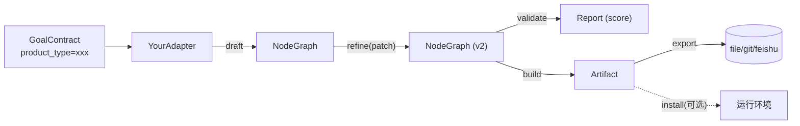

# 适配器开发指南

适配器（Adapter）是 goal-studio 的核心扩展点。每种产物类型（技能 / 代码 / 文档 / 工作流 / 自定义）实现一个 Adapter，把"目标 → 产物"的具体逻辑封装在 6 个方法中。本文档介绍如何从零开发一个自定义适配器。

## 适配器是什么

适配器继承 `BaseAdapter` 抽象基类，覆盖产物全生命周期的 6 个方法。核心引擎通过 `AdapterRegistry` 按 `product_type` 查找适配器实例，调用方完全不需要知道具体产物类型。



### BaseAdapter 六方法

| 方法 | 必填 | 输入 | 输出 | 阶段 |
|------|------|------|------|------|
| `draft(goal)` | 是 | `GoalContract` | `NodeGraph` | Draft — 目标 → 初始三层 DAG |
| `refine(graph, patch)` | 是 | `NodeGraph` + `Patch` | 新 `NodeGraph` | Refine — 应用用户精化补丁 |
| `validate(graph)` | 是 | `NodeGraph` | `Report` | Verify — 产物特定验证，返回 0-100 分 |
| `build(graph)` | 是 | `NodeGraph` | `Artifact` | Build — DAG → 最终产物 |
| `export(artifact, target)` | 是 | `Artifact` + `target` | 导出位置字符串 | Export — 落盘到 file/git/feishu |
| `install(artifact, env)` | 否 | `Artifact` + `env` dict | 安装位置字符串 | Install — 安装到运行环境 |

::: tip 不可变语义
`refine()` 必须返回**新的 `NodeGraph`**，原 `graph` 不被修改。这是棘轮门控回滚的前提。推荐用 `NodeGraph.from_dict(graph.to_dict())` 深拷贝后再修改。
:::

### 核心数据契约

适配器方法的输入输出类型定义在 `goal_studio.core.contract`：

- **`GoalContract`** — 用户目标契约，四要素：`goal` / `prerequisites` / `constraints` / `success_criteria`，加上 `product_type` 决定使用哪个适配器
- **`Patch`** — 精化补丁，包含 `op`（`ADD_NODE` / `UPDATE_NODE` / `REMOVE_NODE` / `ADD_EDGE` / `REMOVE_EDGE` / `REORDER`）、`target_node_id`、`slots`
- **`Report`** — 验证报告，含 `passed` / `score`(0-100) / `dimensions` / `issues` / `suggestions`，`score` 是棘轮门控的依据
- **`Artifact`** — 最终产物，含 `content`(主体) / `files`(多文件 dict) / `metadata` / `graph_snapshot`(溯源快照) / `version`

## 用脚手架快速开始

goal-studio CLI 提供 `scaffold` 命令，一键生成适配器骨架代码：

```bash
goal-studio scaffold --name CustomAdapter --type custom --desc "自定义产物适配器" -o ./adapters
```

参数说明：

| 参数 | 说明 | 示例 |
|------|------|------|
| `--name` | 适配器名称（会自动转 PascalCase 类名） | `CustomAdapter` |
| `--type` | 产物类型标识（唯一 key，不能是默认值 `custom`） | `custom` |
| `--desc` | 一句话描述 | `自定义产物适配器` |
| `-o` / `--output` | 输出目录（默认 `./adapters`） | `./adapters` |

::: warning product_type 必须唯一
`product_type` 是注册中心的唯一 key，不能与内置类型（`skill` / `code` / `doc` / `workflow` / `custom`）冲突，`validate_adapter` 会拒绝默认值 `custom`。
:::

生成的文件结构：

```
./adapters/
└── custom_adapter.py     # 脚手架生成的适配器骨架
```

脚手架生成后会自动调用 `validate_adapter` 检查骨架是否符合规范，并打印下一步指引。

## 实现各方法详解

### 1. draft(goal) → NodeGraph

`draft()` 把 `GoalContract` 四要素转化为初始三层 DAG。通常调用 LLM 生成节点结构，失败时降级到模板。

```python
def draft(self, goal: GoalContract) -> NodeGraph:
    graph = NodeGraph()
    # L1 任务规划层：3-7 个节点
    l1 = Node(
        id="l1-start",
        layer=NodeLayer.L1_PLANNING,   # L1_PLANNING / L2_ALLOCATION / L3_REFINEMENT
        title="开始",
        description=f"处理: {goal.goal[:50]}",
        node_type="task",               # task / agent / tool / decision / io
    )
    graph.add_node(l1)
    graph.root_id = "l1-start"
    return graph
```

::: tip 节点 ID 规范
节点 ID 前缀应匹配层级：`l1-xxx` / `l2-xxx` / `l3-xxx`。`IntentParser` 的启发式规则依赖此前缀做匹配，节点 ID 规范化能显著提升语音指令命中率。
:::

### 2. refine(graph, patch) → NodeGraph

`refine()` 应用 `Patch` 到图，返回新图。`Patch` 由 `IntentParser` 五层流水线解析多模态输入后生成。

```python
def refine(self, graph: NodeGraph, patch: Patch) -> NodeGraph:
    # 深拷贝实现不可变语义
    new_graph = NodeGraph.from_dict(graph.to_dict())
    new_graph.version += 1

    if patch.op == PatchOp.UPDATE_NODE and patch.target_node_id:
        node = new_graph.nodes.get(patch.target_node_id)
        if node:
            node.slots.update(patch.slots)
            if "title" in patch.slots:
                node.title = patch.slots["title"]
            if "description" in patch.slots:
                node.description = patch.slots["description"]
    elif patch.op == PatchOp.ADD_NODE and patch.new_node:
        node = Node(
            id=patch.new_node.get("id", f"n-{uuid.uuid4().hex[:8]}"),
            layer=NodeLayer(patch.new_node.get("layer", 2)),
            title=patch.new_node.get("title", "New Node"),
            description=patch.new_node.get("description", ""),
            slots=patch.new_node.get("slots", {}),
            parent_id=patch.target_node_id,
        )
        new_graph.add_node(node)
    elif patch.op == PatchOp.REMOVE_NODE and patch.target_node_id:
        new_graph.remove_node(patch.target_node_id)
    elif patch.op == PatchOp.ADD_EDGE and patch.target_node_id and patch.target_node_id_2:
        new_graph.add_edge(Edge(
            id=f"e-{patch.target_node_id}-{patch.target_node_id_2}",
            source=patch.target_node_id,
            target=patch.target_node_id_2,
        ))
    return new_graph
```

### 3. validate(graph) → Report

`validate()` 执行产物特定验证，返回 `Report`。`score`(0-100) 是棘轮门控比较的依据——新分数必须 ≥ 历史最佳分数才能 KEEP，否则 REVERT。

```python
def validate(self, graph: NodeGraph) -> Report:
    issues = []
    dims = {}
    if not graph.nodes:
        issues.append("图为空")
        dims["completeness"] = 0.0
    else:
        # 完整性：描述覆盖率
        described = sum(1 for n in graph.nodes.values() if n.description.strip())
        dims["completeness"] = min(100, 50 + (described / len(graph.nodes)) * 50)
    score = sum(dims.values()) / len(dims) if dims else 0
    return Report(
        passed=score >= 70,
        score=score,
        dimensions=dims,
        issues=issues,
        suggestions=[],
        evaluator="custom",
    )
```

::: warning 棘轮门控
`RatchetGate.judge(old_score, new_score, graph)` 决策：`new >= old` → `KEEP`（更新 `best_score` 与 `best_graph`）；否则 → `REVERT`（回滚）。`validate()` 的分数计算必须稳定可复现，避免随机抖动导致频繁回滚。
:::

### 4. build(graph) → Artifact

`build()` 把已验证的 DAG 固化为最终产物。`Artifact.content` 是主体内容，`files` 是多文件 dict，`graph_snapshot` 保留溯源快照。

```python
def build(self, graph: NodeGraph) -> Artifact:
    content = f"# {self.product_type} 产物\n\n由 {self.name} 生成。\n"
    return Artifact(
        product_type=ProductType.CUSTOM,
        content=content,
        files={"output.md": content},
        graph_snapshot=graph.to_dict(),
        metadata={"adapter": self.name},
    )
```

### 5. export(artifact, target) → str

`export()` 把 `Artifact` 落盘到目标位置。`target` 是 URL scheme：`file://./output` / `git://repo` / `feishu://doc`。

```python
def export(self, artifact: Artifact, target: str) -> str:
    if target.startswith("file://"):
        from pathlib import Path
        out_dir = Path(target.replace("file://", ""))
        out_dir.mkdir(parents=True, exist_ok=True)
        for fname, content in artifact.files.items():
            (out_dir / fname).write_text(content, encoding="utf-8")
        return str(out_dir)
    raise ValueError(f"Unsupported export target: {target}")
```

### 6. install(artifact, env) → str（可选）

`install()` 把产物安装到运行环境。基类默认返回"不支持"，子类按需覆盖。例如 `SkillAdapter` 可安装到 maxfun skill 目录。

```python
def install(self, artifact: Artifact, env: dict[str, str]) -> str:
    install_dir = env.get("install_dir")
    if not install_dir:
        return "install_dir not provided in env"
    from pathlib import Path
    out = Path(install_dir) / self.product_type
    out.mkdir(parents=True, exist_ok=True)
    for path, content in artifact.files.items():
        (out / path).write_text(content, encoding="utf-8")
    return f"Installed to {out}"
```

## AdapterMeta 元数据声明

`AdapterMeta` 声明适配器的元数据，供注册中心和文档站展示。声明为类属性 `_meta`：

```python
from goal_studio.core.plugin_sdk import AdapterMeta

class CustomAdapter(BaseAdapter):
    product_type = "custom"
    name = "Custom Adapter"
    description = "自定义产物适配器"

    _meta = AdapterMeta(
        name="Custom Adapter",
        product_type="custom",
        version="0.1.0",
        author="your-name",
        description="自定义产物适配器",
        dependencies=[],          # 依赖的其他 product_type
        homepage="https://github.com/...",
    )
```

| 字段 | 说明 |
|------|------|
| `name` | 适配器显示名 |
| `product_type` | 产物类型标识（唯一 key，须与类属性 `product_type` 一致） |
| `version` | 语义化版本 |
| `author` | 作者 |
| `description` | 一句话描述 |
| `dependencies` | 依赖的其他 `product_type`（如 `workflow` 依赖 `skill`） |
| `homepage` | 项目主页 URL |

`AdapterMeta.from_adapter(adapter)` 会优先取 `_meta`，否则从类属性兜底构造。

## 验证适配器

`validate_adapter(adapter)` 检查适配器是否符合规范，返回问题列表（空列表表示通过）。

```python
from goal_studio.core.plugin_sdk import validate_adapter

issues = validate_adapter(MyAdapter())
if issues:
    for issue in issues:
        print(f"  - {issue}")
else:
    print("适配器验证通过")
```

### 检查项

| 检查项 | 说明 |
|--------|------|
| `product_type` 非空且非默认值 | 不能是空字符串或默认值 `"custom"` |
| `name` 非空且非默认值 | 不能是空字符串或默认值 `"base"` |
| 5 个抽象方法已实现 | `draft` / `refine` / `validate` / `build` / `export` 不能仍是 `@abstractmethod` |
| 方法签名参数完整 | `draft(goal)` / `refine(graph, patch)` / `validate(graph)` / `build(graph)` / `export(artifact, target)` |

::: tip 脚手架自动验证
`goal-studio scaffold` 生成骨架后会自动 import 文件并调用 `validate_adapter`，骨架因为 `product_type` 还是默认值 `"custom"` 会触发告警，提示你修改。
:::

## 注册方式

适配器有两种注册方式：entry_points（包发布）和目录热加载（本地开发）。

### 方式一：entry_points 热加载

适合发布为 pip 包的第三方适配器。在 `pyproject.toml` 声明 entry point，组名固定为 `goal_studio.adapters`：

```toml
[project.entry-points."goal_studio.adapters"]
my_adapter = "my_package.adapters:MyAdapter"
```

注册中心调用 `registry.load_entry_points()` 时会自动发现并实例化所有 entry points（需传入 `BaseAdapter` 子类）。

### 方式二：目录热加载

适合本地开发的适配器。把 `.py` 文件放入目录，CLI 调用 `load_plugins` 加载：

```bash
# 把 custom_adapter.py 放入 ./adapters/ 目录
goal-studio load-plugins --dir ./adapters

# 或在代码中调用
from goal_studio.core.adapter_registry import get_default_registry
registry = get_default_registry()
loaded = registry.load_from_directory("./adapters")
print(f"加载了: {loaded}")
```

`load_from_directory` 扫描目录下所有 `*.py` 文件（跳过 `_` 开头的），import 模块后查找 `BaseAdapter` 子类并实例化注册。已注册的 `product_type` 会静默跳过。

安全约束（PR-O）：
- **目录白名单** — 仅允许加载 `./adapters/`、`~/.goal-studio/adapters/`，或环境变量 `GOAL_STUDIO_PLUGIN_DIRS`（冒号分隔）声明的目录；
- **签名标记** — 每个 `xxx.py` 旁边必须存在 `xxx.signature` 文件才会被加载（`goal-studio scaffold` 会自动生成；手工创建的适配器请自行放置，内容任意，作为人工确认的信任标记）。

::: tip 内置适配器别名
内置适配器注册时带别名：`skill`↔`技能`、`code`↔`代码`、`doc`↔`文档`、`workflow`↔`工作流`。`registry.get("技能")` 与 `registry.get("skill")` 等价。
:::

## 完整示例代码

下面是一个完整的自定义适配器示例，展示 6 方法的典型实现：

```python
"""custom_adapter: 自定义产物适配器完整示例

产物类型: custom_report
"""
from __future__ import annotations

import uuid
from pathlib import Path
from typing import Any

from goal_studio.core.base_adapter import BaseAdapter
from goal_studio.core.contract import (
    Artifact, GoalContract, Patch, PatchOp, ProductType, Report,
)
from goal_studio.core.node_graph import Edge, Node, NodeGraph, NodeLayer
from goal_studio.core.plugin_sdk import AdapterMeta


class CustomAdapter(BaseAdapter):
    """自定义产物适配器 — 把目标转化为 Markdown 报告"""

    product_type = "custom_report"
    name = "Custom Adapter"
    description = "把目标转化为自定义 Markdown 报告"

    _meta = AdapterMeta(
        name="Custom Adapter",
        product_type="custom_report",
        version="0.1.0",
        author="your-name",
        description="把目标转化为自定义 Markdown 报告",
        dependencies=[],
        homepage="",
    )

    def draft(self, goal: GoalContract) -> NodeGraph:
        """目标 → 三层 DAG（模板生成，不依赖 LLM）"""
        graph = NodeGraph()

        # L1 任务规划层
        l1_tasks = [
            ("l1-intro", "引言", f"概述目标: {goal.goal[:40]}"),
            ("l1-body", "正文", "展开目标的关键要点"),
            ("l1-conclusion", "结论", "总结与下一步"),
        ]
        prev = None
        for nid, title, desc in l1_tasks:
            graph.add_node(Node(id=nid, layer=NodeLayer.L1_PLANNING,
                                title=title, description=desc))
            if prev:
                graph.add_edge(Edge(id=f"e-{prev}-{nid}", source=prev, target=nid))
            prev = nid
        graph.root_id = "l1-intro"

        # L2 Agent 分配层
        graph.add_node(Node(id="l2-writer", layer=NodeLayer.L2_ALLOCATION,
                            title="报告撰写者", description="撰写正文",
                            node_type="agent", parent_id="l1-body"))
        return graph

    def refine(self, graph: NodeGraph, patch: Patch) -> NodeGraph:
        """应用精化补丁（不可变语义）"""
        new_graph = NodeGraph.from_dict(graph.to_dict())
        new_graph.version += 1

        if patch.op == PatchOp.UPDATE_NODE and patch.target_node_id in new_graph.nodes:
            node = new_graph.nodes[patch.target_node_id]
            node.slots.update(patch.slots)
            if "title" in patch.slots:
                node.title = patch.slots["title"]
            if "description" in patch.slots:
                node.description = patch.slots["description"]
        elif patch.op == PatchOp.ADD_NODE and patch.new_node:
            new_graph.add_node(Node(
                id=patch.new_node.get("id", f"n-{uuid.uuid4().hex[:8]}"),
                layer=NodeLayer(patch.new_node.get("layer", 2)),
                title=patch.new_node.get("title", "New Node"),
                description=patch.new_node.get("description", ""),
                slots=patch.new_node.get("slots", {}),
                parent_id=patch.target_node_id,
            ))
        elif patch.op == PatchOp.REMOVE_NODE and patch.target_node_id:
            new_graph.remove_node(patch.target_node_id)
        return new_graph

    def validate(self, graph: NodeGraph) -> Report:
        """验证：完整性 + 架构合理性"""
        dims: dict[str, float] = {}
        issues: list[str] = []

        if not graph.nodes:
            issues.append("图为空")
            return Report(passed=False, score=0.0, dimensions={"completeness": 0.0},
                          issues=issues, evaluator="custom")

        # 完整性：描述覆盖率
        described = sum(1 for n in graph.nodes.values() if n.description.strip())
        dims["completeness"] = min(100, 50 + (described / len(graph.nodes)) * 50)

        # 架构：是否有 L1 节点
        l1 = graph.get_layer(NodeLayer.L1_PLANNING)
        dims["architecture"] = 85.0 if l1 else 40.0
        if not l1:
            issues.append("缺少 L1 任务规划节点")

        score = sum(dims.values()) / len(dims)
        return Report(
            passed=score >= 70,
            score=score,
            dimensions=dims,
            issues=issues,
            suggestions=["建议为每个节点补充描述"] if score < 80 else [],
            evaluator="custom",
        )

    def build(self, graph: NodeGraph) -> Artifact:
        """DAG → Markdown 报告"""
        lines = [f"# 自定义报告\n"]
        for node in graph.get_layer(NodeLayer.L1_PLANNING):
            lines.append(f"## {node.title}")
            lines.append(node.description or "(待填充)")
            if node.slots:
                lines.append("\n**参数:**")
                for k, v in node.slots.items():
                    lines.append(f"- {k}: {v}")
            lines.append("")
        content = "\n".join(lines)
        return Artifact(
            product_type=ProductType.CUSTOM,
            content=content,
            files={"report.md": content},
            graph_snapshot=graph.to_dict(),
            metadata={"adapter": self.name, "node_count": len(graph.nodes)},
        )

    def export(self, artifact: Artifact, target: str) -> str:
        """导出到 file://"""
        if not target.startswith("file://"):
            raise ValueError(f"Unsupported target: {target}")
        out_dir = Path(target.replace("file://", ""))
        out_dir.mkdir(parents=True, exist_ok=True)
        for fname, content in artifact.files.items():
            (out_dir / fname).write_text(content, encoding="utf-8")
        return str(out_dir)

    def install(self, artifact: Artifact, env: dict[str, str]) -> str:
        """安装到指定目录"""
        install_dir = env.get("install_dir")
        if not install_dir:
            return "install_dir not provided"
        out = Path(install_dir) / self.product_type
        out.mkdir(parents=True, exist_ok=True)
        for path, content in artifact.files.items():
            (out / path).write_text(content, encoding="utf-8")
        return f"Installed to {out}"

    def get_schema(self) -> dict[str, Any]:
        """返回节点槽位 schema，供前端渲染编辑表单"""
        return {
            "node_types": ["task", "agent"],
            "slots": {
                "task": ["title", "description", "expected_output"],
                "agent": ["role", "tools"],
            },
        }

    def estimate_complexity(self, graph: NodeGraph) -> int:
        """估算复杂度（1-10），决定是否分块执行"""
        n = len(graph.nodes)
        if n <= 5:
            return 2
        if n <= 10:
            return 4
        return 6
```

### 验证与注册

```bash
# 1. 生成脚手架（或手动创建上面的文件）
goal-studio scaffold --name CustomAdapter --type custom_report -o ./adapters

# 2. 编辑 ./adapters/custom_adapter.py，粘贴上面的代码

# 3. 从目录热加载
goal-studio load-plugins --dir ./adapters

# 4. 确认已注册
goal-studio adapters

# 5. 起草 DAG 测试
goal-studio draft --goal "生成季度总结报告" --type custom_report
```

::: tip 非抽象工具方法
`get_schema()`、`estimate_complexity()`、`install()` 是非抽象方法，基类提供默认实现，子类按需覆盖。`get_schema()` 返回的 schema 供前端 `NodeInspector` 渲染节点编辑表单。
:::
