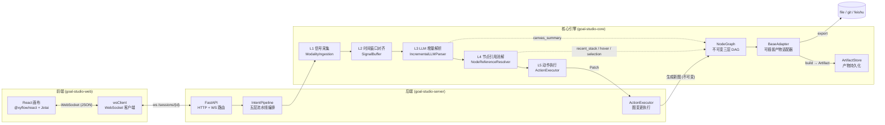
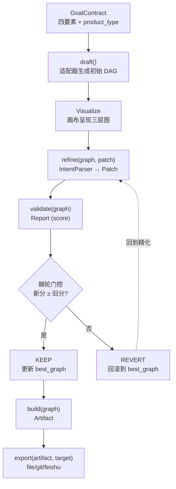

# 架构设计

goal-studio 是一个把"目标 → 可复用产物"的创作过程可视化的 Loop 创作系统。本文档描述整体架构、包结构、数据流与关键设计决策。

## 整体架构

系统采用前后端分离的三层架构：React 前端通过 WebSocket 与 FastAPI 后端实时双向通信，后端调度 IntentParser 五层流水线、ActionExecutor、NodeGraph 与可插拔的产物适配器，最终落盘到 ArtifactStore。



::: tip 架构层次说明
- **前端层**：React 18 画布（基于 `@xyflow/react`）+ Jotai 原子化状态管理，负责三层 DAG 可视化与多模态输入采集。
- **接入层**：FastAPI 提供 HTTP REST（会话、适配器管理）与 WebSocket（实时意图解析、图同步）双协议。
- **核心引擎层**：纯 Python 包 `goal-studio-core`，零网络依赖，可独立 `pip install` 使用。
:::

## 包结构

goal-studio 采用 monorepo 组织，三个核心包职责清晰、单向依赖：

```
goal-studio/
├── packages/
│   ├── goal-studio-core/      # Python 核心引擎 (pip install goal-studio)
│   ├── goal-studio-server/    # FastAPI 后端服务
│   └── goal-studio-web/       # React 前端 (pnpm workspace)
├── examples/                  # 示例项目
├── plugins/                   # 社区适配器
└── .github/workflows/         # CI
```

### goal-studio-core（核心引擎）

核心引擎是整个系统的内核，**不依赖任何 Web 框架**，可独立用于 CLI 或嵌入其他系统。

| 模块 | 职责 |
|------|------|
| `core/` | 核心数据契约与引擎：`NodeGraph`（不可变三层 DAG）、`BaseAdapter`（适配器抽象基类）、`AdapterRegistry`（注册中心 + 热加载）、`RatchetGate`（棘轮门控）、`ArtifactStore`（产物持久化）、`SessionManager`（会话管理）、`KnowledgeStore`（知识沉淀） |
| `adapters/` | 内置适配器实现：`SkillAdapter`（技能）、`CodeAdapter`（代码）、`DocAdapter`（文档）、`WorkflowAdapter`（工作流） |
| `intent_parser/` | 五层意图解析流水线：`pipeline.py`（编排）、`modality_ingestion.py`（L1）、`signal_buffer.py`（L2）、`llm_parser.py`（L3）、`node_resolver.py`（L4）、`action_executor.py`（L5）、`router.py`（模态路由） |
| `llm/` | LLM Provider 抽象层：`base.py`（`BaseLLMProvider`）、`openai_provider.py`、`anthropic_provider.py`、`mock_provider.py`、`registry.py`（按环境变量自动选择） |
| `cli/` | Click 命令行：`init` / `draft` / `view` / `refine` / `verify` / `build` / `serve` / `scaffold` / `adapters` / `load_plugins` |

### goal-studio-server（后端服务）

FastAPI 提供 HTTP + WebSocket 双协议接入，是前端与核心引擎之间的薄层胶水。

| 模块 | 职责 |
|------|------|
| `app.py` | FastAPI 应用入口，挂载路由 |
| `routes/sessions.py` | 会话 REST：创建、列表、详情、更新图 |
| `routes/ws.py` | WebSocket 端点 `ws /sessions/{id}`：`intent_parse` / `voice_chunk` / `mouse_select` / `mouse_hover` |
| `routes/studio.py` | 创作循环编排：draft / refine / verify / build |
| `routes/adapters.py` | 适配器查询与热加载 |
| `ws_protocol.py` | WS 消息构造器：`msg_graph_update` / `msg_intent_parsed` / `msg_node_resolved` / `msg_action_executed` |
| `deps.py` | 依赖注入：`get_session_manager` / `get_adapter_registry` / `get_llm_provider` |
| `models.py` | Pydantic 请求/响应模型 |

### goal-studio-web（前端）

React 18 单页应用，三层画布基于 `@xyflow/react`，状态管理采用 Jotai 原子化方案。

| 模块 | 职责 |
|------|------|
| `components/Canvas/` | 三层画布（L1 规划 / L2 分配 / L3 精化）、`TaskNode` 节点组件 |
| `components/DialogPanel/` | 对话面板，承载多模态输入 |
| `components/NodeInspector/` | 节点检视器，编辑槽位 |
| `components/IntentParser/` | 意图解析状态展示 |
| `hooks/useStreamTranscribe.ts` | 语音流式转录（Web Speech API / Vercel AI SDK 7） |
| `hooks/useIncrementalParse.ts` | 增量解析调度（节流 + WS 推送） |
| `hooks/useSession.ts` | 会话生命周期与 WS 连接 |
| `stores/canvasStore.ts` | 画布原子状态（Jotai） |
| `stores/intentStore.ts` | 意图/信号缓冲原子状态 |
| `api/wsClient.ts` | WebSocket 客户端封装 |

## 数据流

创作循环的核心数据流：用户目标契约进入系统后，依次经过起草、可视化、精化、验证、固化五个阶段，每轮精化都经过棘轮门控，分数只能升不能降。



### 阶段说明

| 阶段 | 输入 | 输出 | 说明 |
|------|------|------|------|
| **draft** | `GoalContract` | `NodeGraph` | 适配器 `draft()` 把目标四要素转化为初始三层 DAG（L1 任务规划 3-7 节点 / L2 Agent 分配 / L3 节点精化） |
| **Visualize** | `NodeGraph` | 画布渲染 | 前端按层次布局渲染，语义缩放自适应 |
| **refine** | `NodeGraph` + `Patch` | 新 `NodeGraph` | 多模态输入经 IntentParser 五层流水线解析为 `Patch`，适配器 `refine()` 应用补丁，**返回新图、原图不变** |
| **validate** | `NodeGraph` | `Report` | 适配器 `validate()` 返回 0-100 分 + 维度明细 + issues/suggestions，分数供棘轮门控比较 |
| **build** | 已验证 `NodeGraph` | `Artifact` | 适配器 `build()` 生成最终产物（SKILL.md / 代码 / 文档 / workflow.json） |
| **export** | `Artifact` + `target` | 导出位置 | 适配器 `export()` 落盘到 `file://` / `git://` / `feishu://` |

::: warning 不可变图语义
`refine()` 必须返回**新的 `NodeGraph` 实例**，原 `graph` 不被修改。这是棘轮门控能够回滚的前提——旧版本的 `best_graph` 始终保留在内存中。`ActionExecutor._apply_patch()` 通过 `NodeGraph.from_dict(graph.to_dict())` 深拷贝实现这一点。
:::

## 关键设计决策

### 1. 不可变图语义

`NodeGraph` 在精化阶段遵循不可变语义：每次 `refine()` / `ActionExecutor.execute()` 都生成新版本（`version += 1`），原图保留。

**收益**：
- 棘轮门控可在分数下降时回滚到 `best_graph`，无需额外快照机制
- 撤销/重做栈（`ActionExecutor._undo_stack`）只需持有图引用，无需深拷贝
- WebSocket 广播图更新时天然支持版本号比对，避免乱序覆盖

### 2. Jotai 原子化状态

前端放弃 Redux/Zustand 单一 store 模式，改用 Jotai 原子化状态：

- `canvasStore.ts` 暴露 `graphAtom`、`selectionAtom`、`hoverAtom`、`viewportAtom` 等细粒度原子
- `intentStore.ts` 暴露 `signalBufferAtom`、`incrementalIntentAtom`、`finalIntentAtom`
- `@xyflow/react` 的节点/边数据通过派生原子从 `graphAtom` 计算，避免重复同步

**收益**：多模态输入（语音/文本/鼠标）各自更新独立原子，React 只重渲染订阅了变化原子的组件，画布拖拽不阻塞意图解析面板。

### 3. WebSocket 实时同步

前后端通过单条 WebSocket 连接（`ws /sessions/{session_id}`）双向通信，所有多模态输入与图更新都走这条通道：

| 客户端 → 服务端 | 服务端 → 客户端 |
|----------------|----------------|
| `intent_parse`（文本/语音最终意图） | `graph_update`（新图 + 版本号） |
| `voice_chunk`（流式 ASR chunk） | `intent_parsed`（解析结果） |
| `mouse_select` / `mouse_hover` | `node_resolved`（节点消解结果） |
| `ping` | `action_executed`（执行结果 + 确认请求） |
|  | `phase_change` / `error` / `pong` |

**收益**：相比 HTTP 轮询，WS 将语音增量解析的端到端延迟控制在 300ms 内（interim chunk 节流间隔）；服务端 `IntentPipeline` 实例按 `session_id` 缓存，避免每条消息重建上下文。

### 4. LLM 降级策略

LLM 调用全链路设计了三级降级，确保单点失败不阻断创作循环：

| 层级 | 触发条件 | 降级动作 |
|------|---------|---------|
| **启发式预解析** | 输入命中 `HEURISTIC_PATTERNS`（如"把 l1-xxx 改成异步"） | 跳过 LLM，直接返回规则匹配的 `ParsedIntent`（`parse_source="heuristic"`） |
| **LRU 缓存** | 相同输入（text + canvas_summary 摘要 hash）命中 | 跳过 LLM，返回缓存结果（`parse_source="cache"`） |
| **模板降级** | LLM 调用异常（网络/超时/JSON 解析失败） | `draft()` 退化为 `_fallback_draft()` 五节点模板；`build()` 退化为 `_fallback_build()` 章节模板 |

::: tip LLM Provider 抽象
`BaseLLMProvider` 统一了 `complete()` / `complete_json()` 接口，`registry.py` 按环境变量（`OPENAI_API_KEY` / `ANTHROPIC_API_KEY`）自动选择 provider，无 key 时回落到 `MockProvider`，保证开发环境零配置可用。
:::

## 技术栈

| 层 | 技术 | 版本 | 用途 |
|----|------|------|------|
| **后端语言** | Python | 3.11+ | 核心引擎与 FastAPI 服务 |
| **后端框架** | FastAPI | - | HTTP + WebSocket 双协议 |
| **数据校验** | Pydantic | v2 | 请求/响应模型、`GoalContract` 等契约 |
| **CLI** | Click | - | `goal-studio` 命令行 |
| **终端渲染** | Rich | - | CLI 表格/颜色输出 |
| **前端语言** | TypeScript | 5 | 全量类型 |
| **前端框架** | React | 18 | 画布与 UI |
| **状态管理** | Jotai | - | 原子化状态 |
| **画布** | @xyflow/react | - | 三层 DAG 可视化 |
| **布局** | ELK.js | - | 层次布局算法 |
| **样式** | Tailwind | v4 | 原子化 CSS |
| **构建** | Vite | - | 前端构建与 HMR |
| **多模态** | Vercel AI SDK | 7 | `streamTranscribe` 流式 ASR |
| **多模态** | Web Speech API | - | 浏览器原生 ASR 降级方案 |
| **实时通信** | WebSocket | - | 前后端双向同步 |
| **文档** | VitePress | 1.3+ | 本文档站点 |

## 理论基础

架构设计融合了以下学术研究：

- **DesignerlyLoop** (Cross) — 设计学循环理论，Draft → Visualize → Refine → Verify 四阶段的哲学基础
- **SkillOpt** (Microsoft) — 技能优化的 9 维评估体系，`SkillAdapter.validate()` 的维度设计来源
- **ParsingDST** (Wu et al.) — LLM 对话状态跟踪，`IncrementalLLMParser` 增量解析与上下文栈的理论依据
- **POLAR** (Yonsei + KAIST) — 个性化实例接地，`NodeReferenceResolver` 三信号融合算法的迁移来源
- **S3-DST** — 多意图分段，一句话含多个意图时的拆分解析策略
