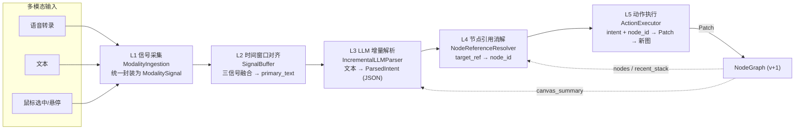
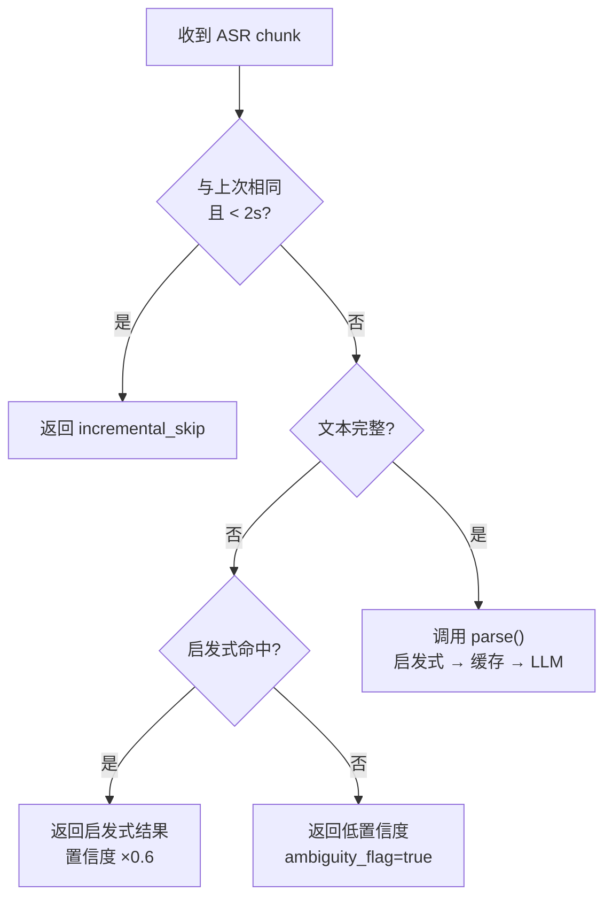
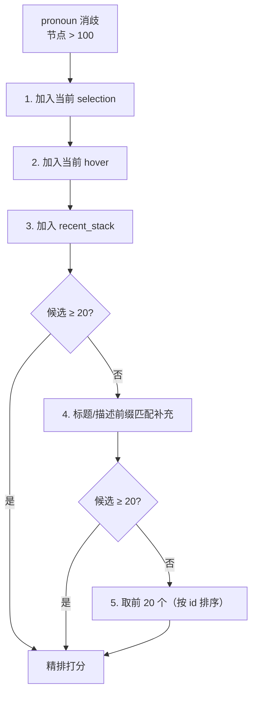
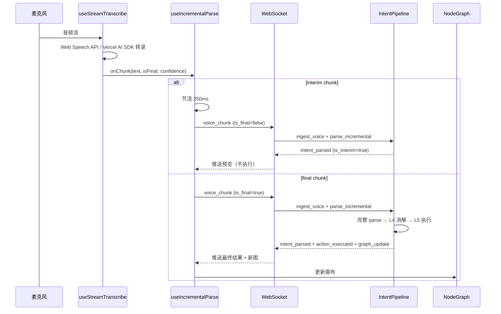
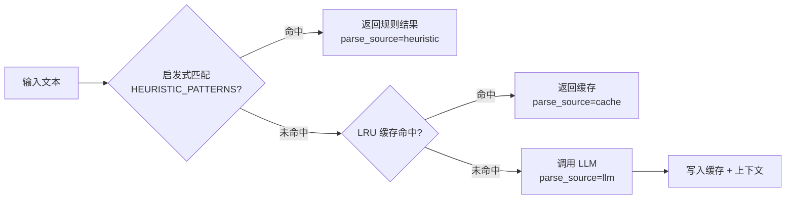
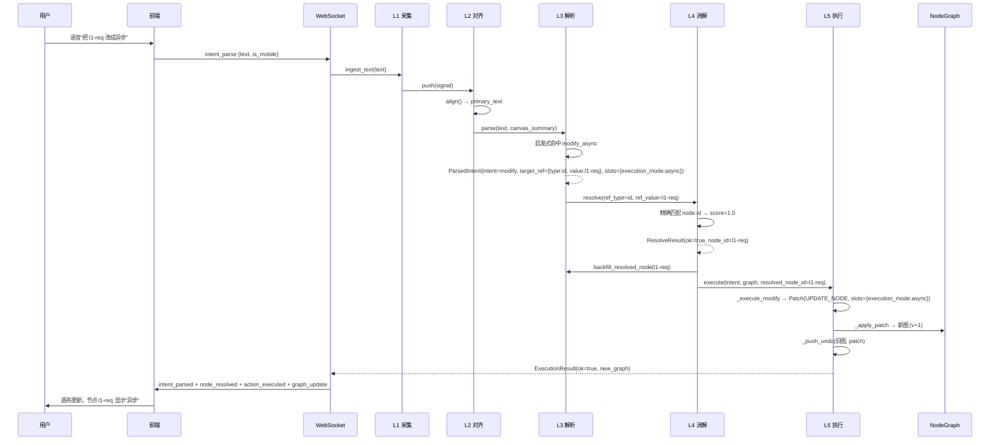

# IntentParser 详解

IntentParser 是 goal-studio 多模态节点编辑的核心。它把语音/文本/鼠标三路输入融合解析为结构化意图，再驱动 DAG 变更。本文档深入解析五层架构、增量解析、节点消解、动作执行与语音流接入。

## 五层架构

IntentParser 由 `IntentPipeline` 编排五层流水线，从多模态信号采集到 DAG 变更执行，逐层递进。每层有明确的输入输出契约，可独立测试。



| 层 | 组件 | 输入 | 输出 |
|----|------|------|------|
| **L1 信号采集** | `ModalityIngestion` | 语音/文本/鼠标原始事件 | `ModalitySignal`（统一信号格式） |
| **L2 时间窗口对齐** | `SignalBuffer` | 多路 `ModalitySignal` | `AlignedSignals`（含 `primary_text` / `selection` / `hover`） |
| **L3 LLM 增量解析** | `IncrementalLLMParser` | 文本 + 画布摘要 | `ParsedIntent`（JSON 中间态） |
| **L4 节点引用消解** | `NodeReferenceResolver` | `target_ref` + 图状态 | `ResolveResult`（含 `node_id` 或澄清选项） |
| **L5 动作执行** | `ActionExecutor` | `ParsedIntent` + `node_id` | `ExecutionResult`（含 `Patch` + 新图） |

::: tip 边界场景：ASR 延迟
ASR 慢时用户可能已切换选中/悬停节点。`IntentPipeline.process()` 在处理开始时锁定 `canvas_snapshot`（说话开始时刻的画布状态），L4 消歧用此快照而非实时状态，保证"说的时候指什么"的语义一致性。
:::

## L3 增量解析

L3 是流水线的智能核心，基于 **ParsingDST** 论文实现。它把自然语言/语音转录解析为结构化 JSON 中间态 `ParsedIntent`，支持增量、缓存、启发式、多意图分段。

### ParsingDST 与 ParsedIntent

`ParsedIntent` 是 L3 的输出契约，是文本到动作之间的 JSON 中间态：

```python
@dataclass
class ParsedIntent:
    intent: str | None = None          # create/modify/delete/connect/query
    target_ref: dict | None = None     # {type, value, confidence}
    slots: dict = field(default_factory=dict)  # 属性键值对
    ambiguity_flag: bool = False       # 是否需要澄清
    clarification_options: list = field(default_factory=list)  # 候选节点 ID
    raw_text: str = ""                 # 原始输入
    parse_confidence: float = 0.0      # 解析置信度
    parse_source: str = "llm"          # llm/heuristic/cache/incremental_partial/fallback
    segment_index: int = 0             # 多意图分段索引
```

`target_ref.type` 取值：

| type | 含义 | 示例输入 |
|------|------|---------|
| `id` | 显式节点 ID | "把 l1-req 改成异步" |
| `name` | 节点名称 | "把需求分析节点改成异步" |
| `spatial` | 空间语言 | "把左边那个改成异步" |
| `property` | 属性描述 | "把高优先级的改成异步" |
| `pronoun` | 代词 | "把它改成异步"（需 L4 消歧） |

### parse_incremental 增量解析

`parse_incremental(current_text)` 是流式 ASR 场景的入口。每收到一个 ASR chunk 调用一次，根据文本完整性走不同策略：



完整性判定（`_is_complete`）规则：
- 标点结尾（`。！？!?.\n`）
- 含明确动词且长度 ≥ 6（如"把 l1-req"）
- 含节点 ID 引用（`l1-xxx` / `l2-xxx` / `l3-xxx`）
- 长度 ≥ 10

::: warning 不完整文本的处理
不完整文本（如流式 ASR 中途的"把 l1"）不会调用 LLM，而是尝试启发式预解析（命中则置信度 ×0.6 降权）或返回低置信度（0.2）的歧义标记。前端据此把 interim 结果分流到 `incrementalIntent` 预览区，不触发动作执行。
:::

### interim / final 双通道

流式 ASR 区分 interim（未确认）和 final（已确认）chunk，处理路径不同：

| chunk 类型 | 前端调度 (`useIncrementalParse`) | 服务端 (`_handle_voice_chunk`) |
|-----------|--------------------------------|------------------------------|
| **interim** (`is_final=false`) | 节流 250ms 后发 `voice_chunk` | 节流 300ms（`_INTERIM_MIN_INTERVAL`）后调 `parse_incremental`，结果标记 `is_interim=true` |
| **final** (`is_final=true`) | 立即发 `voice_chunk`，取消挂起的节流 | 立即调 `parse_incremental`（走完整 `parse`），结果不标记 `is_interim` |

### 节流策略

节流在两层生效，避免每个 ASR chunk 都触发 LLM：

1. **前端节流**（`useIncrementalParse`）：interim chunk 默认 250ms 间隔，挂起的最新文本通过定时器延迟发送
2. **服务端节流**（`_handle_voice_chunk`）：同一文本 300ms 内不重复解析（`_INTERIM_MIN_INTERVAL=0.3`）
3. **解析器去重**（`parse_incremental`）：与上次增量文本相同且 < 2s，返回 `incremental_skip`

### LRU 缓存

`LRUParseCache` 缓存解析结果，key = `hash(text) : hash(canvas_summary[:200])`。画布摘要只取前 200 字符参与 hash，避免图微小变化（如节点位置调整）导致缓存失效。默认容量 64，命中时 `parse_source="cache"`。

## L4 节点消解

L4 把 `target_ref`（id/name/spatial/property/pronoun）解析为具体的 `node_id`。基于 **POLAR** 论文的三信号融合算法，结合共指消解与视觉接地。

### 五种引用类型

| ref_type | 候选生成 | 主要打分信号 |
|----------|---------|------------|
| `id` | 精确匹配 `node.id` | 信号 A：显式匹配（w=1.0，命中直接返回 1.0） |
| `name` | `title` / `description` 包含匹配 | 信号 A + 信号 E：语义相似度（w=0.25） |
| `spatial` | 返回全部节点，由 `_eval_spatial` 打分 | 信号 F：空间语言（w=0.3） |
| `property` | 返回全部节点，由 `_eval_property` 打分 | 信号 G：属性描述（w=0.3） |
| `pronoun` | 默认全部节点；大规模 DAG 先过滤 | 信号 B/C/D：选中/悬停/最近栈 |

### 打分公式

```
score = w1·explicit + w2·selection + w3·hover + w4·recency + w5·semantic + w6·spatial + w7·property
final_score = score × asr_confidence
```

| 信号 | 权重 | 说明 |
|------|------|------|
| A 显式匹配 | 1.0 | id/name 精确命中 |
| B 当前选中 | 0.4 | `node.id == selection` |
| C 鼠标悬停 | 0.35 | `node.id == hover` |
| D 最近编辑栈 | 0.15 | 越近权重越高（`1.0 - idx/len`） |
| E 语义相似度 | 0.25 | Jaccard 相似度（MVP，Phase 2 接 embedding） |
| F 空间语言 | 0.3 | "左边/上面"等空间描述 |
| G 属性描述 | 0.3 | "高优先级/红色"等属性 |

::: tip 歧义阈值
`AMBIGUITY_THRESHOLD = 0.2`：当 top1 与 top2 候选分数差 < 0.2 时，返回 `ok=false` + `clarification_options`（前 5 个候选 ID），前端弹出"你指的是哪个节点？"澄清面板。
:::

### 大规模 DAG 过滤

当节点数 > 100（`LARGE_DAG_THRESHOLD`）时，pronoun 模式不再对全节点打分（避免 O(n²)），而是先过滤到 20 个候选（`LARGE_DAG_CANDIDATE_CAP`）再精排：



### 省略恢复

当用户说"把它改成异步"但没明确"它"指谁（`target_ref.type=pronoun` 且 `value` 为空）时，`_restore_from_context` 从上下文栈恢复：
1. 优先取最近一个 `resolved_node_id`（L4 回填的节点 ID）
2. 否则取最近一个 `target_ref`

L4 消解成功后会调用 `parser.backfill_resolved_node(node_id)` 回填到上下文栈，供后续省略恢复使用。

## L5 动作执行

L5 把 `ParsedIntent` + `node_id` 转为 `Patch` 并应用到图，生成新版本。支持 undo/redo 栈，拓扑校验前置。

### 五种动作

| 动作 | PatchOp | 说明 | 边界场景 |
|------|---------|------|---------|
| `modify` | `UPDATE_NODE` | 更新节点 `slots` / `title` / `description` | - |
| `create` | `ADD_NODE` | 在 `parent_id` 下创建子节点 | - |
| `delete` | `REMOVE_NODE` | 删除节点 | **级联确认**：有子节点时返回 `needs_confirmation`，前端确认后带 `force=true` 重调 |
| `connect` | `ADD_EDGE` | 连接两个节点 | **循环检测**：成环时返回 `cycle_path`，提示断开哪条边 |
| `query` | - | 查询，不修改图 | 直接返回查询结果 |

### 棘轮快照

每次成功的 mutation 都压入 undo 栈：

```python
def _push_undo(self, graph: NodeGraph, patch: Patch) -> None:
    self._undo_stack.append((graph, patch))  # 保存执行前的图
    self._redo_stack.clear()
    if len(self._undo_stack) > self._max_history:  # 默认 50
        self._undo_stack.pop(0)
```

- `undo(current_graph)`：弹出 undo 栈顶（执行前的图），当前图压入 redo 栈
- `redo(current_graph)`：弹出 redo 栈顶，当前图压入 undo 栈

::: tip 与棘轮门控的区别
undo/redo 是 L5 内部的操作级回滚（用户主动撤销单步）；棘轮门控是验证阶段的分数级回滚（`validate()` 分数下降时自动回滚到 `best_graph`）。两者独立工作。
:::

### 级联确认

删除有子节点的节点时，`_execute_delete` 不立即删除，而是返回 `needs_confirmation=true` + `confirmation_context.cascade_nodes`：

```python
# 有级联且未确认 → 返回确认请求（不实际删除）
if cascade_nodes and not force:
    return ExecutionResult(
        ok=False,
        needs_confirmation=True,
        reason=f"删除「{node.title}」将级联删除 {len(cascade_nodes)} 个下游节点",
        confirmation_context={
            "op": "delete",
            "target_node_id": node_id,
            "cascade_nodes": cascade_nodes,  # [{id, title}, ...]
        },
    )
```

前端展示级联节点列表，用户确认后带 `force=true` 重新调用 `_handle_intent_parse`，此时跳过门控直接删除。

### 循环检测

`connect` 操作前置拓扑校验，`graph._find_cycle_path(source, target)` 检测加边后是否成环。成环时返回 `cycle_path`（节点路径）与 `cycle_edges`，提示用户断开哪条边：

```python
cycle = graph._find_cycle_path(source_id, target_id)
if cycle is not None:
    return ExecutionResult(
        ok=False,
        reason=f"连接 {source_id} → {target_id} 会形成环",
        cycle_path=cycle,
        confirmation_context={
            "op": "connect",
            "cycle_path": cycle,
            "cycle_edges": [[cycle[i], cycle[i+1]] for i in range(len(cycle)-1)],
        },
    )
```

### 多模态冲突

当鼠标悬停节点 A 但语音指令指向节点 B 时，L5 不阻断执行（语音优先），但附带 `conflict_warning` 告警：

```
多模态冲突: 鼠标悬停「需求分析」但指令指向「方案设计」,已按指令执行(语音优先)
```

## 语音流接入

语音从麦克风到 DAG 变更的完整链路：前端转录 → 增量解析调度 → WS 推送 → 后端 `parse_incremental` → 前端预览/执行。



### useStreamTranscribe（前端转录）

`useStreamTranscribe` 抽象了两类 ASR provider：

| provider | 实现 | 适用场景 |
|----------|------|---------|
| `webspeech`（默认） | 浏览器 Web Speech API，零依赖 | 开发环境降级方案 |
| `vercel-ai` | Vercel AI SDK 7 `streamTranscribe`，消费 NDJSON 流 | 生产环境，需后端 `/api/transcribe` 端点 |

暴露 `onChunk(chunk, isFinal, confidence)` 回调，`interimTranscript` 用于实时预览，`transcript` 累积最终文本。

### useIncrementalParse（增量调度）

`useIncrementalParse` 接收 `useStreamTranscribe` 的 chunk，负责节流与 WS 推送：

```typescript
const { handleChunk } = useIncrementalParse({
  sendVoiceChunk: sendVoiceChunk,  // 由 useSession 提供
  throttleMs: 250,                  // interim 节流间隔
});

// 接入转录
const { start, stop } = useStreamTranscribe({
  onChunk: handleChunk,             // 转录 chunk → 增量调度
  provider: "webspeech",
});
```

`handleChunk` 的双通道逻辑：
- **始终**推入 `intentStore.signalBuffer`（供 L2 时间窗口对齐）
- **interim**：节流后 `sendVoiceChunk(text, confidence, false)`
- **final**：取消挂起的节流定时器，立即 `sendVoiceChunk(text, confidence, true)`

### WS voice_chunk → parse_incremental

服务端 `_handle_voice_chunk` 处理 WS 消息：

```python
async def _handle_voice_chunk(ws, session_id, payload, pipeline):
    text = payload.get("text", "")
    confidence = payload.get("confidence", 0.9)
    is_final = payload.get("is_final", False)

    # L1 采集 → L2 缓冲
    pipeline.ingest_voice(text, confidence)

    # interim 节流：同一文本 300ms 内不重复解析
    if not is_final:
        state = _interim_throttle.get(session_id, {"last_text": "", "last_ts": 0.0})
        now = time.time()
        if text == state["last_text"] or (now - state["last_ts"]) < 0.3:
            return
        _interim_throttle[session_id] = {"last_text": text, "last_ts": now}

    # L3 增量解析
    intent = await loop.run_in_executor(None, lambda: pipeline.parser.parse_incremental(
        text,
        canvas_summary=pipeline._build_canvas_summary(),
        dialog_history=pipeline.dialog_history,
    ))
    intent_dict = intent.to_dict()
    intent_dict["asr_confidence"] = confidence
    if not is_final:
        intent_dict["is_interim"] = True
        # 强制前缀化 parse_source，保证前端分流一致
        if not intent_dict["parse_source"].startswith("incremental_"):
            intent_dict["parse_source"] = f"incremental_{intent_dict['parse_source']}"
    await _send_json(ws, msg_intent_parsed(session_id, intent_dict).model_dump())
```

::: warning interim 不触发执行
interim chunk 的解析结果只推送预览，**不进入 L4/L5**。只有 `intent_parse` 消息（文本输入或 final chunk 确认后）才会走完整五层流水线并触发图变更。
:::

## 启发式规则

`HEURISTIC_PATTERNS` 是规则模式库，命中时跳过 LLM 调用，直接返回 `ParsedIntent`（`parse_source="heuristic"`）。这是 LLM 降级策略的第一道防线。

### 解析顺序



### 内置规则

| 规则名 | 模式（示例） | intent | 提取的 slots |
|--------|-------------|--------|-------------|
| `modify_async` | `把 l1-xxx 改成异步` | modify | `{execution_mode: async}` |
| `modify_sync` | `把 l1-xxx 改成同步` | modify | `{execution_mode: sync}` |
| `add_retry` | `把 l1-xxx 加重试 3 次` | modify | `{retry_count: 3}`（slot_extractor） |
| `set_timeout` | `把 l1-xxx 超时 30 秒` | modify | `{timeout: 30}`（slot_extractor） |
| `modify_title` | `把 l1-xxx 标题改成 XXX` | modify | `{title: XXX}`（slot_extractor） |
| `delete_node` | `删除 l1-xxx` | delete | - |
| `create_node` | `新增节点 XXX` | create | `{title: XXX}`（slot_extractor） |
| `connect_nodes` | `连接 l1-a 和 l1-b` | connect | `{target_node_id: l1-b}`（slot_extractor） |

::: tip slot_extractor
复杂规则用 `slot_extractor`（lambda 函数）从正则匹配组提取 slots。简单规则直接用静态 `slots` 字段。规则的 `ref_type` 决定 L4 走哪条消歧路径。
:::

### 启发式在增量解析中的降权

`parse_incremental` 对不完整文本尝试启发式时，命中结果会 `parse_confidence *= 0.6` 降权，并标记 `parse_source="incremental_partial"`，避免不完整匹配误触发动作。

## 多意图分段

基于 **S3-DST** 论文，一句话含多个意图时分段解析。`INTENT_SEPARATORS` 定义分隔词：

```python
INTENT_SEPARATORS = ["然后", "接着", "再", "之后", "并且", "同时",
                     "，", "；", ";", " and ", " then "]
```

### 分段示例

输入：`把 l1-req 改成异步，然后删除 l1-design`

`_split_segments` 按分隔符拆分为两段，`parse_segments` 返回分段列表：

```python
parser.parse_segments("把 l1-req 改成异步，然后删除 l1-design")
# 返回:
# [
#   ParsedIntent(intent="modify", target_ref={type:id, value:"l1-req"},
#                slots={execution_mode:"async"}, segment_index=0),
#   ParsedIntent(intent="delete", target_ref={type:id, value:"l1-design"},
#                segment_index=1),
# ]
```

### 单意图 vs 多意图

| 方法 | 行为 |
|------|------|
| `parse(text)` | 检测到多意图时只解析第一段（`segment_index=0`），后续段存入上下文栈待连续处理 |
| `parse_segments(text)` | 解析所有分段，返回 `list[ParsedIntent]` |

::: warning 上下文栈容量
上下文栈默认容量 10（`context_capacity=10`），超出时自动修剪保留最近的 10 条。每条记录含 `turn` / `intent` / `target_ref` / `slots` / `raw_text` / `resolved_node_id`（L4 回填）。
:::

## 完整数据流示例

以语音输入"把 l1-req 改成异步"为例，追踪五层流水线的完整执行：



::: tip 全程无 LLM 调用
此例因命中 `modify_async` 启发式规则，全程跳过 LLM，端到端延迟 < 50ms。这是 goal-studio 在高频节点编辑场景下保持流畅的关键。
:::
